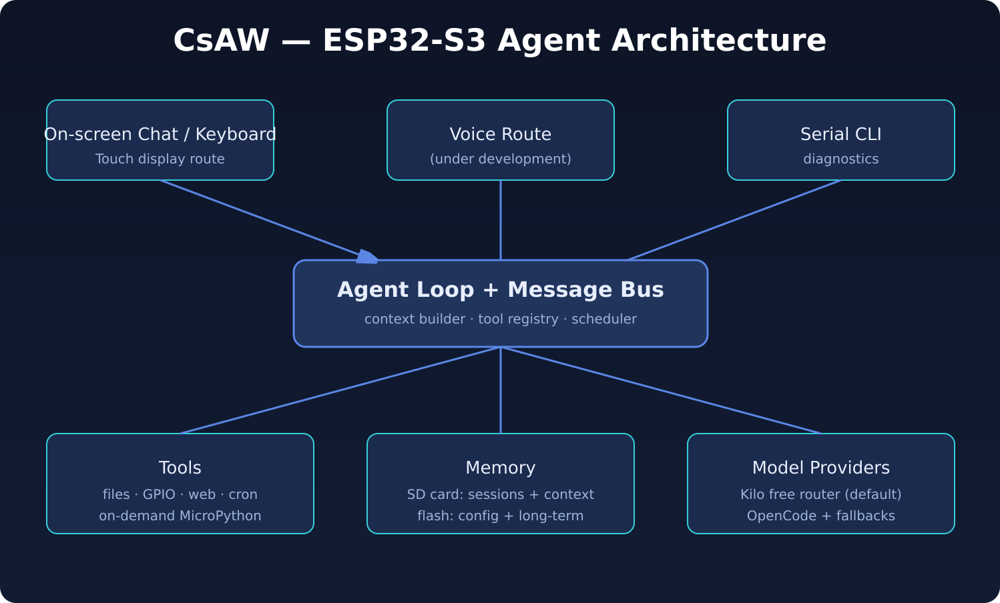
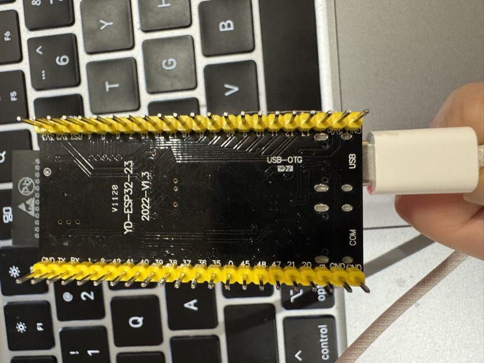

# CsAW: Pocket AI Assistant on a $5 Chip

<p align="center">
  
</p>

<p align="center">
  <a href="LICENSE"></a>
  <a href="https://deepwiki.com/rrdlabs/csaw_esp32s3_genesis"></a>
  <a href="https://discord.gg/r8ZxSvB8Yr"></a>
  <a href="https://x.com/ssslvky"></a>
</p>

<p align="center">
  <strong><a href="README.md">English</a> | <a href="README_CN.md">中文</a> | <a href="README_JA.md">日本語</a></strong>
</p>

**The world's first AI assistant(OpenClaw) on a $5 chip. No Linux. No Node.js. Just pure C**

CsAW turns a tiny ESP32-S3 board into a personal AI assistant. Power the Rev 1 AMOLED board, connect to WiFi, and type on its on-screen keyboard — it handles tasks and evolves with local memory, all on a chip the size of a thumb. Telegram/Feishu remain optional legacy channels.

## Meet CsAW

- **Tiny** — No Linux, no Node.js, no bloat — just pure C
- **Handy** — Message it from Telegram, it handles the rest
- **Loyal** — Learns from memory, remembers across reboots
- **Energetic** — USB power, 0.5 W, runs 24/7
- **Lovable** — One ESP32-S3 board, $5, nothing else

## How It Works



You type on the **on-screen keyboard** of the Rev 1 AMOLED board. The ESP32-S3 feeds the text into an agent loop — the LLM thinks, calls tools, reads memory — and the reply appears in the same on-screen chat view. Uses **free-provider routers** (Kilo default, OpenCode fallback, OpenRouter additional fallback) with automatic fallback, switchable at runtime. Everything runs on a single chip; serial/CLI is for diagnostics and Telegram/Feishu are optional legacy channels (disabled by default). See [docs/ON_DEVICE_UI.md](docs/ON_DEVICE_UI.md).

## Quick Start

### What You Need

- An **ESP32-S3-TOUCH-AMOLED-1.8 Rev 1** board (SH8601 display + FT3168 touch) with 16 MB flash and 8 MB PSRAM
- A **USB Type-C cable**
- **No IM bot token needed** — the on-screen chat UI is the default; Telegram/Feishu are optional legacy channels
- **No paid API key required** — Kilo free router works anonymously (200 req/hr/IP); optional tokens can be added for higher limits

### Install

```bash
# You need ESP-IDF v6.1+ installed first:
# https://docs.espressif.com/projects/esp-idf/en/v6.1/esp32s3/get-started/

git clone https://github.com/rrdlabs/csaw_esp32s3_genesis.git
cd csaw

idf.py set-target esp32s3
```

<details>
<summary>Ubuntu Install</summary>

Recommended baseline:

- Ubuntu 22.04/24.04
- Python >= 3.10
- CMake >= 3.16
- Ninja >= 1.10
- Git >= 2.34
- flex >= 2.6
- bison >= 3.8
- gperf >= 3.1
- dfu-util >= 0.11
- `libusb-1.0-0`, `libffi-dev`, `libssl-dev`

Install and build on Ubuntu:

```bash
sudo apt-get update
sudo apt-get install -y git wget flex bison gperf python3 python3-pip python3-venv \
  cmake ninja-build ccache libffi-dev libssl-dev dfu-util libusb-1.0-0

./scripts/setup_idf_ubuntu.sh
./scripts/build_ubuntu.sh
```

</details>

<details>
<summary>macOS Install</summary>

Recommended baseline:

- macOS 12/13/14
- Xcode Command Line Tools
- Homebrew
- Python >= 3.10
- CMake >= 3.16
- Ninja >= 1.10
- Git >= 2.34
- flex >= 2.6
- bison >= 3.8
- gperf >= 3.1
- dfu-util >= 0.11
- `libusb`, `libffi`, `openssl`

Install and build on macOS:

```bash
xcode-select --install
/bin/bash -c "$(curl -fsSL https://raw.githubusercontent.com/Homebrew/install/HEAD/install.sh)"

./scripts/setup_idf_macos.sh
./scripts/build_macos.sh
```

</details>

### Configure

CsAW uses a **two-layer config** system: build-time defaults in `csaw_secrets.h`, with runtime overrides via the serial CLI. CLI values are stored in NVS flash and take priority over build-time values.

```bash
cp main/csaw_secrets.h.example main/csaw_secrets.h
```

Edit `main/csaw_secrets.h`:

```c
#define CSAW_SECRET_WIFI_SSID       "YourWiFiName"
#define CSAW_SECRET_WIFI_PASS       "YourWiFiPassword"
#define CSAW_SECRET_TG_TOKEN        "123456:ABC-DEF1234ghIkl-zyx57W2v1u123ew11"
#define CSAW_SECRET_API_KEY         ""              // optional free-router token
#define CSAW_SECRET_MODEL_PROVIDER  "kilo"           // "kilo", "opencode", or "openrouter"
#define CSAW_SECRET_SEARCH_KEY      ""              // optional: Brave Search API key
#define CSAW_SECRET_TAVILY_KEY      ""              // optional: Tavily API key (preferred)
#define CSAW_SECRET_PROXY_HOST      ""              // optional: e.g. "10.0.0.1"
#define CSAW_SECRET_PROXY_PORT      ""              // optional: e.g. "7897"
```

Then build and flash:

```bash
# Clean build (required after any csaw_secrets.h change)
idf.py fullclean && idf.py build

# Find your serial port
ls /dev/cu.usb*          # macOS
ls /dev/ttyACM*          # Linux

# Flash and monitor (replace PORT with your port)
# USB adapter: likely /dev/cu.usbmodem11401 (macOS) or /dev/ttyACM0 (Linux)
idf.py -p PORT flash monitor
```

> **Important: Plug into the correct USB port!** Most ESP32-S3 boards have two USB-C ports. You must use the one labeled **USB** (native USB Serial/JTAG), **not** the one labeled **COM** (external UART bridge). Plugging into the wrong port will cause flash/monitor failures.
>
> <details>
> <summary>Show reference photo</summary>
>
> 
>
> </details>

### CLI Commands (via UART/COM port)

Connect via serial to configure or debug. **Config commands** let you change settings without recompiling — just plug in a USB cable anywhere.

**Runtime config** (saved to NVS, overrides build-time defaults):

```
csaw> wifi_set MySSID MyPassword   # change WiFi network
csaw> set_tg_token 123456:ABC...   # change Telegram bot token
csaw> set_provider_key kilo <token> # optional free-router token
csaw> set_model_provider opencode  # switch provider (kilo|opencode|openrouter)
csaw> set_model mimo-v2.6-flash-free # change free model
csaw> set_proxy 127.0.0.1 7897  # set HTTP proxy
csaw> clear_proxy                  # remove proxy
csaw> set_search_key BSA...        # set Brave Search API key
csaw> set_tavily_key tvly-...      # set Tavily API key (preferred)
csaw> config_show                  # show all config (masked)
csaw> config_reset                 # clear NVS, revert to build-time defaults
```

**Debug & maintenance:**

```
csaw> wifi_status              # am I connected?
csaw> memory_read              # see what the bot remembers
csaw> memory_write "content"   # write to MEMORY.md
csaw> heap_info                # how much RAM is free?
csaw> session_list             # list all chat sessions
csaw> session_clear 12345      # wipe a conversation
csaw> heartbeat_trigger           # manually trigger a heartbeat check
csaw> cron_start                  # start cron scheduler now
csaw> restart                     # reboot
```

### USB (JTAG) vs UART: Which Port for What

Most ESP32-S3 dev boards expose **two USB-C ports**:

| Port | Use for |
|------|---------|
| **USB** (JTAG) | `idf.py flash`, JTAG debugging |
| **COM** (UART) | **REPL CLI**, serial console |

> **REPL requires the UART (COM) port.** The USB (JTAG) port does not support interactive REPL input.

<details>
<summary>Port details & recommended workflow</summary>

| Port | Label | Protocol |
|------|-------|----------|
| **USB** | USB / JTAG | Native USB Serial/JTAG |
| **COM** | UART / COM | External UART bridge (CP2102/CH340) |

The ESP-IDF console/REPL is configured to use UART by default (`CONFIG_ESP_CONSOLE_UART_DEFAULT=y`).

**If you have both ports connected simultaneously:**

- USB (JTAG) handles flash/download and provides secondary serial output
- UART (COM) provides the primary interactive console for the REPL
- macOS: both appear as `/dev/cu.usbmodem*` or `/dev/cu.usbserial-*` — run `ls /dev/cu.usb*` to identify
- Linux: USB (JTAG) → `/dev/ttyACM0`, UART → `/dev/ttyUSB0`

**Recommended workflow:**

```bash
# Flash via USB (JTAG) port
idf.py -p /dev/cu.usbmodem11401 flash

# Open REPL via UART (COM) port
idf.py -p /dev/cu.usbserial-110 monitor
# or use any serial terminal: screen, minicom, PuTTY at 115200 baud
```

</details>

## Memory

CsAW keeps low-churn files in flash and all high-churn memory on the installed SD card (see [docs/STORAGE_POLICY.md](docs/STORAGE_POLICY.md)):

| Location | What it is |
|----------|------------|
| `/spiffs/config/SOUL.md` | Personality — edit this to change how the assistant behaves |
| `/spiffs/config/USER.md` | Info about you — name, preferences, language |
| `/spiffs/memory/MEMORY.md` | Long-term memory (flash, low churn) |
| `/spiffs/cron.json` | Scheduled jobs — recurring or one-shot tasks |
| `/sd/csaw/context/HEARTBEAT.md` | Task list checked periodically (SD working memory) |
| `/sd/csaw/context/daily/2026-02-05.md` | Daily notes (SD, rotated after 14 days) |
| `/sd/csaw/sessions/local.jsonl` | On-screen chat history (SD, rotated) |

Use `storage_status` in the CLI to check SD usage and rotation limits.

## Tools

CsAW supports tool calling across all free providers — the LLM can call tools during a conversation and loop until the task is done (ReAct pattern).

| Tool | Description |
|------|-------------|
| `web_search` | Search the web via Tavily (preferred) or Brave for current information |
| `get_current_time` | Fetch current date/time via HTTP and set the system clock |
| `cron_add` | Schedule a recurring or one-shot task (the LLM creates cron jobs on its own) |
| `cron_list` | List all scheduled cron jobs |
| `cron_remove` | Remove a cron job by ID |

To enable web search, set a [Tavily API key](https://app.tavily.com/home) via `CSAW_SECRET_TAVILY_KEY` (preferred), or a [Brave Search API key](https://brave.com/search/api/) via `CSAW_SECRET_SEARCH_KEY` in `csaw_secrets.h`.

## Cron Tasks

CsAW has a built-in cron scheduler that lets the AI schedule its own tasks. The LLM can create recurring jobs ("every N seconds") or one-shot jobs ("at unix timestamp") via the `cron_add` tool. When a job fires, its message is injected into the agent loop — so the AI wakes up, processes the task, and responds.

Jobs are persisted to SPIFFS (`cron.json`) and survive reboots. Example use cases: daily summaries, periodic reminders, scheduled check-ins.

## Heartbeat

The heartbeat service periodically reads `HEARTBEAT.md` from SPIFFS and checks for actionable tasks. If uncompleted items are found (anything that isn't an empty line, a header, or a checked `- [x]` box), it sends a prompt to the agent loop so the AI can act on them autonomously.

This turns CsAW into a proactive assistant — write tasks to `HEARTBEAT.md` and the bot will pick them up on the next heartbeat cycle (default: every 30 minutes).

## Also Included

- **WebSocket gateway** on port 18789 — connect from your LAN with any WebSocket client
- **OTA updates** — flash new firmware over WiFi, no USB needed
- **Dual-core** — network I/O and AI processing run on separate CPU cores
- **HTTP proxy** — CONNECT tunnel support for restricted networks
- **Free-provider chain** — Kilo free router → OpenCode → OpenRouter with automatic fallback
- **Cron scheduler** — the AI can schedule its own recurring and one-shot tasks, persisted across reboots
- **Heartbeat** — periodically checks a task file and prompts the AI to act autonomously
- **Tool use** — ReAct agent loop with tool calling on all free providers

## For Developers

Technical details live in the `docs/` folder:

- **[docs/ARCHITECTURE.md](docs/ARCHITECTURE.md)** — system design, module map, task layout, memory budget, protocols, flash partitions
- **[docs/TODO.md](docs/TODO.md)** — feature gap tracker and roadmap
- **[docs/WIFI_ONBOARDING_AP.md](docs/WIFI_ONBOARDING_AP.md)** — how the local `CsAW-XXXX` onboarding/admin AP flow works
- **[docs/tool-setup/](docs/tool-setup/README.md)** — configuration guides for external service integrations (Tavily, etc.)

## Contributing

Please read **[CONTRIBUTING.md](CONTRIBUTING.md)** before opening issues or pull requests.

## Contributors

Thanks to everyone who has contributed to CsAW.

<a href="https://github.com/rrdlabs/csaw_esp32s3_genesis/graphs/contributors">
  
</a>

## License

MIT

## Acknowledgments

Inspired by [OpenClaw](https://github.com/openclaw/openclaw) and [Nanobot](https://github.com/HKUDS/nanobot). CsAW reimplements the core AI agent architecture for embedded hardware — no Linux, no server, just a $5 chip.

## Star History

<a href="https://www.star-history.com/?repos=memovai%2Fcsaw&type=date&legend=top-left">
 <picture>
   <source media="(prefers-color-scheme: dark)" srcset="https://api.star-history.com/image?repos=rrdlabs/csaw_esp32s3_genesis&type=date&theme=dark&legend=top-left" />
   <source media="(prefers-color-scheme: light)" srcset="https://api.star-history.com/image?repos=rrdlabs/csaw_esp32s3_genesis&type=date&legend=top-left" />
   
 </picture>
</a>
